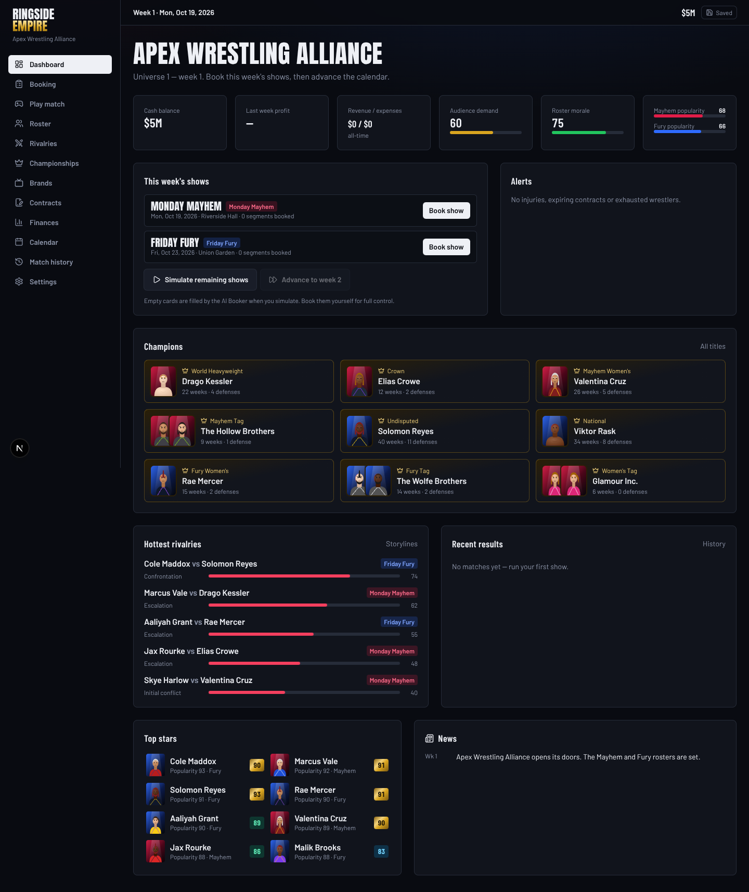
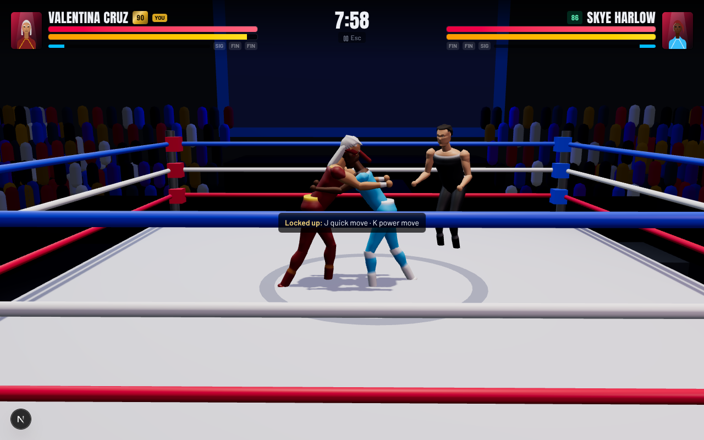

# Ringside Empire

A browser wrestling game and promotion management simulator: book weekly shows for two brands, build
rivalries and championships, manage contracts and money across a persistent universe, and step into a 3D
ring to play matches yourself.



> **Roster.** Personal-use fan build. Two brands, **WWE** (*Monday Night Raw*) and **AEW** (*AEW Dynamite*),
> with their men's rosters, plus **Legends & Icons** (some with several eras) and a few free agents: 134
> wrestlers in all. Every rating is a subjective gameplay estimate. Names only, no logos, music or artwork.
> Edit the roster in `src/data/roster-source.ts`, then run `npm run roster`.
>
> **3D wrestlers.** Every wrestler is one CC0 MakeHuman body (`public/models/human.bin`: 13k vertices, a game
> skeleton with fingers, 100 anatomical morphs, eyes/brows/lashes/hair), mixed and sculpted per wrestler
> (build, face structure, gear volume) and painted in a shader (photographic skin detail, ring gear, boots,
> pads, gloves, tattoos, masks, face paint). Rebuild the model with
> `blender -b --python scripts/blender/bake_human.py -- public/models` (needs Blender, MPFB2 and the MakeHuman
> system assets). Knockdowns and slams use Rapier ragdolls;
> grapples use arm IK. Portraits are rendered from the 3D model. Tweak anyone in the Character Studio.

---

## Quick start

Requirements: **Node.js 20.9+** (developed on Node 22) and npm.

```bash
npm install
npm run dev            # http://localhost:3000
```

Open the app, click **New universe**, then **Start universe**. No accounts, API keys or network services are
needed: the whole game runs in the browser and saves to IndexedDB.

| Script | What it does |
| --- | --- |
| `npm run dev` | Development server |
| `npm run build` / `npm start` | Production build / serve it |
| `npm run typecheck` | TypeScript, no emit |
| `npm run lint` | ESLint (Next.js + React Compiler rules) |
| `npm test` | Vitest unit tests for the engine (39 tests) |
| `npm run e2e` | Playwright end-to-end smoke tests (builds and serves on :3100) |
| `npm run roster` | Regenerate `src/data/roster.json` from `src/data/roster-source.ts` |
| `npm run sim:season [weeks]` | Headless season simulation, for balance checks |
| `npm run sim:match` | Headless playable-match engine run (bot vs AI) |
| `npm run seed:supabase` | Optional: seed a starter cloud save (service-role key, server-side only) |

---

## What's in the game

### Universe and management
- **Dashboard:** cash, last-week profit, revenue and expenses, audience demand, roster morale, brand popularity,
  this week's shows, alerts (injuries, expiring contracts, exhausted wrestlers), champions, hottest rivalries,
  recent results, top stars and news.
- **Roster** (69 wrestlers: two brands, Legends with era versions, free agents): search, filters by brand,
  division, style, alignment and status, sortable rating columns.
- **Wrestler profile:** five separate ratings (overall, in-ring, entertainment, popularity, current form, plus
  potential), 20 attributes, a "why this overall" weight breakdown, moveset, contract, title history,
  rivalries and recent matches.
- **Rating editor:** every attribute with live overall recalculation, manual overall override, restore
  defaults, alignment, brand, salary, finisher and signatures, tag teams. Also **alternate versions** (e.g. a
  "Peak 2004" copy) that never overwrite the original, and **custom wrestlers**.
- **3D character studio** (`/roster/[id]/look`): sculpted muscular models with sliders for muscle mass,
  definition, body fat, frame, shoulders, arms, legs, height and weight; face, hair, facial hair and mask; ring
  gear, boots, kneepads and tape. Includes body presets, seven poses (double biceps, lat spread, most
  muscular…), orbit and zoom, a turntable, and a reset to the original look.
- **Brands:** separate rosters, titles, popularity, reputation, payroll, ratings history; transfers, trades and
  a balanced snake draft; optional cross-brand bookings.
- **Championships:** nine titles (world, midcard, tag, women's, cross-brand women's tag) with prestige,
  full lineage, defences, vacate and award.
- **Contracts:** sign, renew and release, with a live "interest" preview, counter-offers, signing bonuses,
  severance, expiry and optional auto-renewal. Legends accept only short deals. All money is fictional.
- **Finances:** ledger-driven revenue and expense charts, cash balance with a forecast, breakdowns by source,
  type and brand, and the full transaction list.
- **Calendar:** weekly shows plus a premium live event every fourth week, booked title matches, contract
  expiries and injury returns.
- **Match history:** filter by source (simulated, booked or played), star rating and title matches.
- **Settings:** AI difficulty, match length, graphics quality, sound, reduced motion, booking rules, key
  remapping, rating-formula weights per style, save slots, export/import, reset, cloud saves and credits.

### Booking and simulation
- **Card builder:** promos, interviews, rivalry segments and matches (singles, tag, triple threat) with six
  stipulations, title stakes, rivalry links, durations, main event, and AI-simulated or booked finishes.
  Segments can be reordered by drag or arrow buttons. Venue, ticket price and marketing come with a live
  attendance and revenue projection.
- **Validation:** blocks double-booking, injured or unsigned talent, wrong-brand talent, mixed divisions,
  champions missing from their own title match, tag titles in singles matches, the same title twice on a card,
  and malformed matches. Warnings flag fatigue, overwork and back-to-back rematches.
- **AI Booker:** deterministic heuristics with no external AI. It builds a full card around active rivalries,
  overdue title defences and well-matched pairings, gives every suggestion a score and its reasons, and lets
  you accept, reject, edit, or replace the whole card.
- **Match simulator** (`src/engine/simulation.ts`): win probability comes from ability, popularity, momentum,
  form, big-match skill, recent record, stipulation fit, champion's advantage, tag chemistry and injuries,
  with a softmax that keeps an underdog floor, so upsets happen. Quality (0–100, shown as 0–5★) comes from
  in-ring performance, pacing and psychology, crowd engagement, reversals and style chemistry, stakes,
  repetition and fatigue. It's seeded and deterministic per save.
- **Show results:** rating, attendance, viewership, fan satisfaction, revenue and expense breakdown, brand
  and wrestler popularity changes, injuries, title changes, and narrated summaries. Weak booking costs you:
  thin cards, talk-heavy cards, PLEs with no title on the line, rematches, flat main events and overworked
  stars all hurt.
- **Rivalries:** five stages (initial conflict → resolution), intensity, fan interest, win-loss series, event
  timeline, automatic decay and fizzling. New feuds start from upsets and title changes. Storyline suggestions
  cover number-one contenders, face and heel turns, tag-team splits and rising stars. You can create, edit,
  pause and end rivalries yourself.
- **Weekly loop:** payroll and overhead, fatigue recovery, injuries, morale, contract countdowns, development
  toward potential, age-related decline and audience-demand drift.

### Playable 3D match


- One-on-one matches against an AI opponent, either as a **quick match** (optionally for a title) or a
  **booked match** played straight from a show card ("Play this match"). A booked result is locked in and used
  when the show runs.
- Movement inside the ropes, light and heavy strikes, running attacks, stomps, lock-ups with quick and power
  follow-ups, timed reversals (on-screen prompt), dodges, signatures and finishers driven by a momentum meter,
  stamina drain and recovery, knockdowns and get-ups, pinfalls with the referee's count, kick-out and
  submission-escape mash meters, time limit, and a results screen with stats.
- The AI reacts to distance, health, stamina, the state of the match and its own recent moves. Finishers are
  strong, but they don't automatically win.
- Visuals: an original arena (ring, ropes, turnbuckles, stage, instanced crowd that reacts to crowd heat),
  sculpted wrestler models with keyframed animations, a referee, hit sparks, camera tracking and shake.
  Sound is synthesised at runtime.
- Robustness: if WebGL is unavailable or the 3D scene errors, the match switches to a **2D top-down view** and
  stays playable. A low-graphics setting is there for older laptops. Phones get on-screen touch controls.

**Default controls** (remap them in Settings):

| Key | Action |
| --- | --- |
| W A S D / arrows | Move |
| Shift (hold) | Run; light strike while running is a running attack |
| J | Light strike (stomps a downed opponent) |
| K | Heavy strike |
| L | Grapple, then J for a quick move or K for a power move |
| R | Reverse, timed to the opponent's wind-up (blue prompt) |
| Space | Dodge |
| F / G | Signature / finisher (when SIG / FIN light up) |
| P | Pin; mash it to kick out or escape a hold |
| Esc | Pause |

---

## Architecture

The engine is plain TypeScript with no React imports. It's unit-tested and runs headless (`scripts/`).
Everything about a universe is a single versioned JSON document.

| Brief module | Where it lives |
| --- | --- |
| `game-engine` (weekly loop, contracts, roster operations) | `src/engine/universe.ts`, `src/engine/calendar.ts` |
| `match-simulation` | `src/engine/simulation.ts` |
| playable match engine | `src/engine/live-match.ts` |
| `wrestler-rating` | `src/engine/rating.ts` |
| `booking-engine` (validation, AI Booker) | `src/engine/booking.ts` |
| `storyline-engine` | `src/engine/storyline.ts` |
| `financial-engine` | `src/engine/finance.ts` |
| `universe-state` | `src/store/game.ts` (Zustand) |
| `persistence` | `src/lib/persistence.ts` (IndexedDB), `src/engine/schema.ts` (Zod schema + migrations), `src/lib/cloud.ts` (Supabase) |
| `3d-renderer` | `src/components/match3d/*` (arena, anatomy/body sculpting, rig and poses, match scene, studio, 2D fallback) |
| `ui` | `src/components/ui/primitives.tsx`, `src/components/*`, `src/app/**` |
| data | `src/data/roster-source.ts` → `roster.json`, `src/data/seed.ts` (brands, titles, venues, rivalries) |

**Rating model.** Overall = 78% style-weighted in-ring + 12% entertainment (charisma, promo, crowd connection)
+ 10% big-match performance. Each of the eight styles weights the 15 in-ring attributes differently: a
technician leans on technical, grappling, reversals and psychology; a powerhouse on strength, durability and
grappling. You can change the weights in Settings. Overall, in-ring, entertainment, popularity, current form
and potential are always stored and shown separately. The ratings are fixed in the roster database and
never randomised at runtime.

**Saves.** Autosave goes to IndexedDB: the first change is written immediately, rapid bursts such as slider
drags are debounced, and an emergency copy is kept on page unload. You get multiple slots, plus export and
import of JSON files validated with Zod. The schema is versioned (`schemaVersion`, currently 2) with forward
migrations; v1 → v2 added the physique fields. Portraits you upload are stored in a separate IndexedDB store,
not inside saves.

**Determinism.** All randomness comes from a seeded PRNG (`src/engine/rng.ts`), keyed by the universe seed
plus show, segment or week ids.

---

## Optional: Supabase cloud saves

The game works fully without this. To sync saves across devices:

1. Create a Supabase project. In **Authentication → Providers**, enable **Email**. In **URL configuration**,
   add your site URL (e.g. `https://your-app.vercel.app`) and `http://localhost:3000`.
2. Run `supabase/migrations/0001_universe_saves.sql` in the SQL editor (or `supabase db push`). It creates
   `universe_saves` with row-level security, so players can only read and write their own rows.
3. Copy `.env.example` to `.env.local` and fill in:
   ```
   NEXT_PUBLIC_SUPABASE_URL=https://<project>.supabase.co
   NEXT_PUBLIC_SUPABASE_ANON_KEY=<anon public key>
   ```
4. Restart. **Settings → Cloud saves** then offers an email sign-in link, plus upload, download and delete.

Only the public anon key goes to the browser. `npm run seed:supabase` uses `SUPABASE_SERVICE_ROLE_KEY` and must
only run on your own machine or in CI.

---

## Deploy to Vercel

1. Push the repository to GitHub, GitLab or Bitbucket.
2. In Vercel, choose **Add New → Project** and import the repo. The framework preset is **Next.js**. Leave the
   defaults: build `next build`, output handled by Vercel, Node 20+.
3. (Optional) Add `NEXT_PUBLIC_SUPABASE_URL` and `NEXT_PUBLIC_SUPABASE_ANON_KEY` under **Settings →
   Environment Variables**, then redeploy.
4. Deploy. Every page is static or client-rendered, with no server functions or database required.

From the CLI: `npm i -g vercel && vercel` (preview) and `vercel --prod`.

---

## Testing

- `npm test`: **39 unit tests**:
  - the rating formula (weighted, style-aware, overrides, tiers);
  - the match simulator (determinism, upsets, quality depends on more than overall, booked finishes, no
    title change on a DQ, star scale);
  - booking validation (empty cards, double-booking, injuries, brands, unsigned talent, divisions,
    cross-brand toggle, title rules, match shape) and the AI Booker (valid scored cards, PLE title);
  - finances (ledger and cash, ticket-price elasticity, star power, payroll and overhead);
  - the weekly loop (records, popularity, history, rivalries, title change with lineage, a 12-week season);
  - contracts (counter-offers, bonuses, release vacates titles and pays severance);
  - saves (round trip, invalid and future-version rejection, IndexedDB slots, v1 → v2 migration);
  - default physiques.
- `npm run e2e`: Playwright smoke tests:
  - a new universe from the main menu (desktop and mobile);
  - roster search plus a rating edit that survives reload;
  - empty-card blocking, then an AI Booker card run, with results reaching history and finances;
  - week advance surviving reload;
  - playable match start, input and pause;
  - a character studio save.

  Set `E2E_BASE_URL` to target a running server, and `PW_CHROMIUM_PATH` to use a system Chromium.

### Verified functionality
These were checked in a real browser during development:
- **Basics.** The app starts, all 21 routes render, TypeScript and ESLint are clean, and the production build
  succeeds.
- **Roster.** The main menu launches a universe. Wrestlers can be searched and edited, overall recalculates
  live, and edits survive reloads.
- **Booking and shows.** Weekly shows can be booked, and invalid bookings are rejected. Shows simulate; results
  update records, popularity, history, rivalries and the cash balance. Championships change on decisive title
  wins.
- **Playable match.** A singles match was played to a pinfall through the real keyboard controls. The result
  was recorded in history, and the booked-match result was used when its show ran.
- **Saves and fallback.** Save, load, export and import work. The 3D studio saves looks. The 2D fallback renders
  if WebGL fails.

### Known limitations
- Tag-team, triple-threat and battle-royal matches are simulated, not playable. Playable matches are singles.
- No real wrestler likenesses or official artwork are included, by design (see the top of this file).
- Wrestler models are procedural, with no imported GLB/GLTF. Animations are keyframed, not motion-captured.
- Cloud saves need your own Supabase project. The game is otherwise fully offline.
- Sound effects are simple synthesised placeholders. There's no licensed music.

---

## Credits and licensing
- Code, procedural portraits, 3D arena and wrestler models, and synthesised sound: original to this project.
- Fonts: Anton, Barlow and Barlow Condensed via Fontsource (SIL Open Font License 1.1), self-hosted.
- Icons: Lucide (ISC). Libraries: Next.js, React, Three.js, React Three Fiber and Drei, Zustand, Zod, Recharts,
  idb-keyval and Supabase JS, under their respective licences.
- This is an independent fan project, not affiliated with any wrestling promotion. All names and characters are
  fictional; any resemblance is coincidental.
